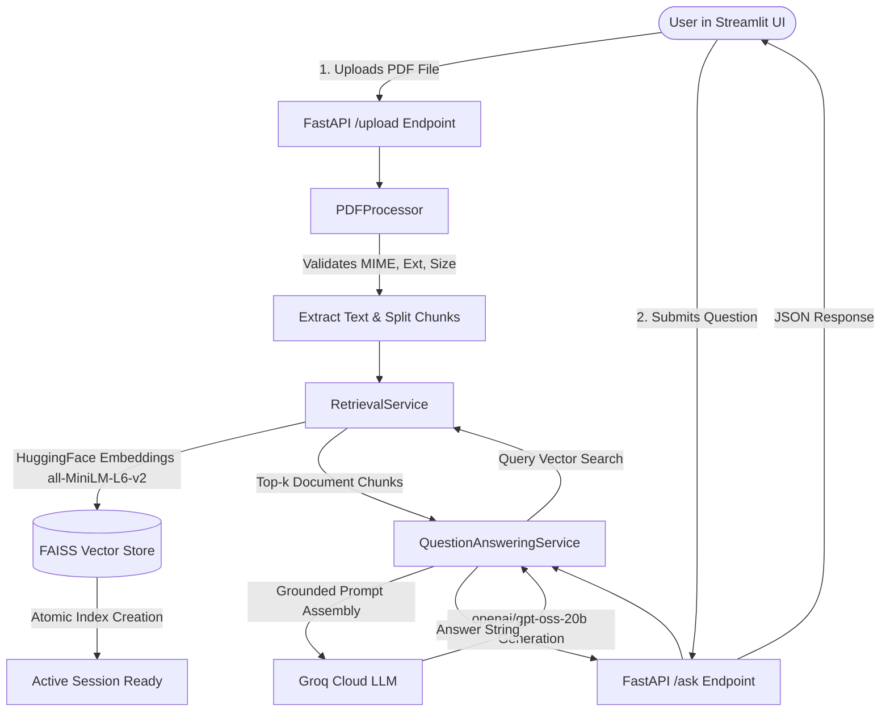
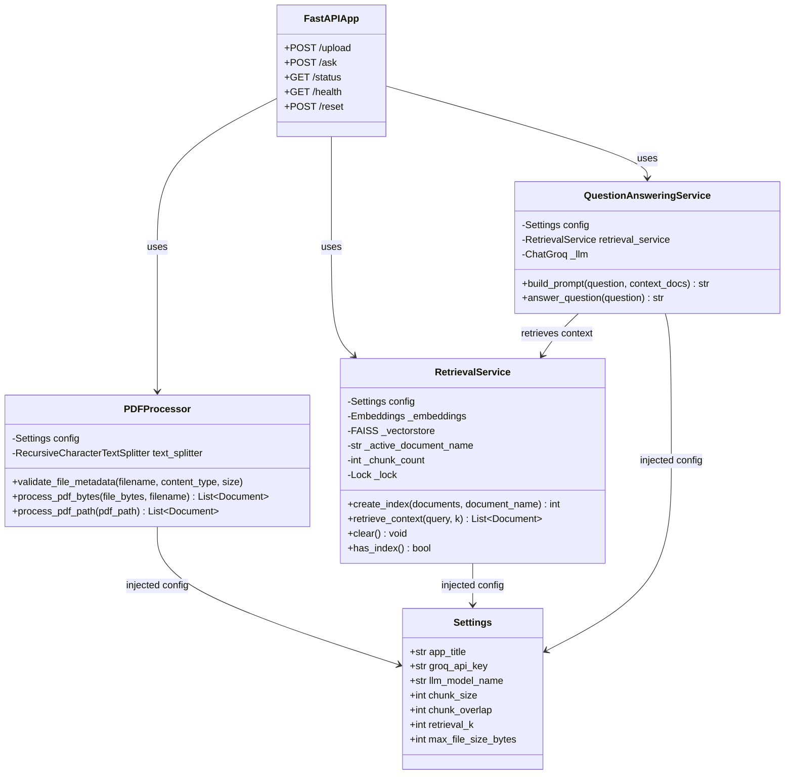
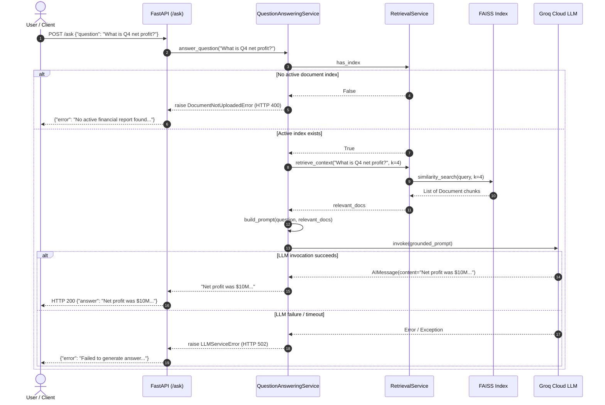

# 📊 Financial Report RAG Analyzer

A modular, production-ready Retrieval-Augmented Generation (RAG) system engineered to parse, index, and answer domain-specific questions on corporate financial reports (earnings releases, 10-K, 10-Q statements) using **FastAPI**, **Streamlit**, **FAISS**, **Hugging Face Sentence-Transformers**, and **Groq Cloud LLMs**.

This repository is structured around rigorous software engineering principles, serving as an implementation baseline for academic evaluations in **Object Oriented Modeling and Design (OOMD)** and **Software Testing and Quality Assurance (STQA)**.

---

## 📑 Table of Contents
1. [Project Overview](#-project-overview)
2. [Workflow & Execution Pipeline](#-workflow--execution-pipeline)
3. [System Architecture & Class Design](#-system-architecture--class-design)
4. [Object Oriented Modeling and Design (OOMD) Mapping](#-object-oriented-modeling-and-design-oomd-mapping)
5. [Software Testing and Quality Assurance (STQA) Mapping](#-software-testing-and-quality-assurance-stqa-mapping)
6. [Technology Stack](#-technology-stack)
7. [Repository Structure](#-repository-structure)
8. [Installation & Setup](#-installation--setup)
9. [Running the Application](#-running-the-application)
10. [Automated Testing & Verification](#-automated-testing--verification)
11. [Current Limitations & Future Scope](#-current-limitations--future-scope)
12. [Security & License](#-security--license)

---

## 🎯 Project Overview

Financial reports are dense, data-heavy documents containing key financial figures, operational commentary, and forward-looking guidance. Finding specific numbers (such as quarterly gross margin, EBITDA changes, or segment revenue) manually is time-consuming and error-prone. Standard generic LLMs often hallucinate financial metrics when answering without strict context grounding.

### Objectives & Capabilities
* **Accurate Context Grounding:** Enforce strict retrieval grounding—the language model answers questions using *only* retrieved text from the uploaded report. If the information is absent, it responds with `"The report does not specify."`
* **Object-Oriented Architecture:** Decoupled service layer (`PDFProcessor`, `RetrievalService`, `QuestionAnsweringService`) with dependency injection and centralized settings.
* **Resilient State & Error Handling:** Atomic index replacement, safe temporary file cleanup, and defensive HTTP error mappings.
* **100% Automated Test Coverage:** Offline, deterministic unit and integration test suite measuring statement and branch coverage.

---

## 🔄 Workflow & Execution Pipeline



### End-to-End Processing Steps
1. **Upload & Ingestion:** The user selects a financial PDF in the Streamlit sidebar. Streamlit sends a multipart form request to `POST /upload`.
2. **Validation & Extraction:** `PDFProcessor` validates file metadata (MIME type, file extension `.pdf`, size limit $\le 25\text{ MB}$, and `%PDF-` magic bytes). It extracts pages with `PyPDFLoader` and segments text into overlapping windows (default: $1000$ characters, $200$ overlap) using `RecursiveCharacterTextSplitter`.
3. **Embedding & Indexing:** `RetrievalService` transforms chunks into 384-dimensional dense vectors using the `all-MiniLM-L6-v2` embedding model and compiles an in-memory `FAISS` similarity index.
4. **Natural-Language Querying:** The user submits a financial query. Streamlit calls `POST /ask`.
5. **Context Retrieval:** `RetrievalService` performs cosine similarity search on the active FAISS index to retrieve the top-$k$ ($k=4$) most relevant document chunks.
6. **Prompt Assembly & LLM Generation:** `QuestionAnsweringService` injects the retrieved context into a grounded prompt template and invokes the Groq LLM API.
7. **Delivery:** The structured answer is rendered in the interactive Streamlit chat interface.

### Model Configuration & Environment Overrides
* **Default Model:** `openai/gpt-oss-20b` (hosted on Groq Cloud).
* **Configurable Overrides:** The model ID can be customized without code changes via the `GROQ_MODEL_NAME` or `LLM_MODEL_NAME` environment variables in `.env`.
* **Embedding Model:** `sentence-transformers/all-MiniLM-L6-v2` (runs locally).

---


## 🏛️ System Architecture & Class Design

<<<<<<< HEAD
The application follows the **Single Responsibility Principle (SRP)** and **Dependency Inversion**, cleanly separating HTTP routing, domain validation, vector indexing, and generative AI execution.



### Implemented Modules & Responsibilities
* **`PDFProcessor` (`app/services/pdf_processor.py`):** Responsible for file validation (rejecting non-PDFs, oversized files, corrupted headers), safe temporary file lifecycle (`try...finally: os.remove`), and document text chunking.
* **`RetrievalService` (`app/services/retrieval_service.py`):** Encapsulates vector generation, FAISS index management, and similarity search. Protects state transitions using a thread lock (`threading.Lock`) to ensure atomic index replacement.
* **`QuestionAnsweringService` (`app/services/qa_service.py`):** Coordinates prompt construction, contextual grounding instructions, LLM invocation via Groq, and fallback formatting (`"The report does not specify."`).
* **`Settings` (`app/config.py`):** Centralized Pydantic configuration loaded from environment variables and `.env`.
* **`Pydantic Models` (`app/models.py`):** Enforces request/response data contracts (`QuestionRequest`, `QuestionResponse`, `UploadResponse`, `StatusResponse`, `ErrorResponse`).
* **`Domain Exceptions` (`app/exceptions.py`):** Custom domain hierarchy (`InvalidFileError`, `CorruptedPDFError`, `EmptyDocumentError`, `DocumentNotUploadedError`, `IndexingError`, `LLMServiceError`) mapped to standardized HTTP status codes (400, 413, 422, 500, 502).
* **`Dependencies` (`app/dependencies.py`):** Provides dependency injection singletons for FastAPI endpoints and test fixture overrides.

---

## 📐 Object Oriented Modeling and Design (OOMD) Mapping

The refactored backend maps directly to fundamental OOMD concepts and serves as the reference implementation for formal UML modeling artifacts (class, use case, sequence, activity, state, and component diagrams).

> **Note for Evaluators:** The Mermaid diagrams in this README document the actual codebase implementation and illustrate the design principles that formal UML submission diagrams model.

### 1. Object-Oriented Principles in the Implementation
* **Encapsulation:** Internal details—such as vector embeddings, index pointers, and temp file descriptors—are encapsulated within their respective service classes (`RetrievalService`, `PDFProcessor`) and exposed only through well-defined public methods.
* **Single Responsibility Principle (SRP):**
  * `PDFProcessor` only handles parsing, chunking, and validation.
  * `RetrievalService` only manages vector embeddings and similarity queries.
  * `QuestionAnsweringService` only manages prompt grounding and LLM communication.
* **Dependency Injection (DI):** Services accept dependencies (such as embeddings, LLMs, or configuration objects) via their constructors, enabling offline testing with test doubles.
* **Defensive State Management:** The active vector store is modified atomically under a lock, preventing race conditions or corrupt intermediate states during failed uploads.

### 2. Interaction Sequence Diagram (Question Answering)



### 3. UML Modeling Reference Guide
* **Use Case Diagram:** Actors: *Financial Analyst / User*, *Groq LLM Service*. Use Cases: *Upload Financial Report*, *Validate PDF*, *Index Document*, *Ask Financial Question*, *Reset Session*.
* **State Machine Diagram:** Application transitions between states: `Idle (No Document)` $\rightarrow$ `Processing Upload` $\rightarrow$ `Document Active (Indexed)` $\rightarrow$ `Querying Context` $\rightarrow$ `Resetting`.
* **Component Diagram:** Illustrates dependencies between `Streamlit Frontend`, `FastAPI REST Gateway`, `Service Layer`, `FAISS Engine`, and `Groq API`.

---

## 🧪 Software Testing and Quality Assurance (STQA) Mapping

The testing strategy implements modern software quality assurance practices, combining unit testing, integration testing, boundary value validation, and branch coverage analysis.

### 1. Quality Assurance Dimensions Implemented
* **Unit Testing:** Tests individual business methods in isolation (`PDFProcessor`, `RetrievalService`, `QuestionAnsweringService`).
* **API & Integration Testing:** Uses Starlette / FastAPI `TestClient` to execute complete HTTP request-response cycles, verifying status codes, schema validation, and exception handlers.
* **Negative & Boundary Testing:** Verifies rejection of non-PDFs (`.txt`), empty files (0 bytes), corrupted PDF headers, whitespace-only queries, oversized files ($>25\text{ MB}$), and queries before document upload.
* **State Preservation & Rollback Testing:** Verifies that if an existing valid report is indexed and a subsequent upload of a corrupted file fails, the original active report is preserved intact.
* **Test Doubles & Mocking:** External dependencies (Hugging Face model downloads and Groq cloud API requests) are isolated in tests using deterministic mock embeddings (`DeterministicMockEmbeddings`) and mock chat models (`MockChatLLM`).
* **Code Coverage:** Statement and branch coverage measured using `pytest-cov` and `Coverage.py`.

### 2. Actual Automated Test & Coverage Results

> **Verification Run Command:**
> ```powershell
> .\venv\Scripts\python.exe -m pytest -v --cov=app --cov-branch --cov-report=term-missing
> ```

**Execution Summary:**
* **Total Tests:** 52
* **Passed:** 52 (100%)
* **Failed:** 0
* **Execution Time:** ~0.64s

```
=============================== tests coverage ================================
Name                                Stmts   Miss Branch BrPart  Cover   Missing
-------------------------------------------------------------------------------
app\__init__.py                         0      0      0      0   100%
app\config.py                          19      0      0      0   100%
app\dependencies.py                    13      0      0      0   100%
app\exceptions.py                      26      0      0      0   100%
app\main.py                            47      0      0      0   100%
app\models.py                          24      0      2      0   100%
app\services\__init__.py                4      0      0      0   100%
app\services\pdf_processor.py          58      0     20      0   100%
app\services\qa_service.py             38      0      8      0   100%
app\services\retrieval_service.py      67      0      6      0   100%
-------------------------------------------------------------------------------
TOTAL                                 296      0     36      0   100%
======================= 52 passed, 3 warnings in 0.64s ========================
```

> **Scope Clarification:** 100% statement and branch coverage applies strictly to our application code under `app/`. High coverage is an essential quality indicator demonstrating all code branches are exercised, though live external verification remains important for end-to-end cloud connectivity.

---

## 🛠️ Technology Stack

| Component / Tool | Technology / Library | Version | Actual Role in Project |
| :--- | :--- | :--- | :--- |
| **Language** | Python | `3.11+ / 3.13` | Core runtime language |
| **Backend Web Framework** | FastAPI | `0.129.0` | High-performance asynchronous REST API backend |
| **ASGI Server** | Uvicorn | `0.41.0` | ASGI web server hosting FastAPI |
| **Frontend UI** | Streamlit | `1.54.0` | Interactive web frontend for PDF upload and financial chat |
| **Data Validation** | Pydantic / Pydantic-Settings | `2.12.5` | Request parsing, strict type checking, and configuration |
| **Document Splitting** | LangChain Text Splitters | `1.1.1` | Recursive chunking of financial text |
| **PDF Loader** | PyPDF / LangChain Community | `6.7.1` | Binary extraction of text from PDF files |
| **Embeddings Model** | Hugging Face Sentence-Transformers | `all-MiniLM-L6-v2` | Dense vector embedding generation for semantic search |
| **Vector Storage** | FAISS (CPU) | `1.13.2` | In-memory similarity search and vector indexing |
| **Language Model Client** | LangChain Groq (`ChatGroq`) | `1.1.2` | Groq Cloud integration with `openai/gpt-oss-20b` |
| **Automated Testing** | Pytest | `9.1.1` | Unit and integration test runner |
| **Test Coverage** | Pytest-Cov / Coverage.py | `7.1.0` | Line and branch coverage measurement |
| **HTTP Client Testing** | HTTPX / Starlette TestClient | `0.28.1` | In-process API integration testing without network calls |

---

## 📂 Repository Structure

```
Financial_report_analyzer/
│
├── app/                              # Core application package
│   ├── __init__.py                   # Package exports
│   ├── config.py                     # Centralized Settings & environment overrides
│   ├── exceptions.py                 # Domain exception hierarchy (HTTP mapped)
│   ├── models.py                     # Pydantic schemas (QuestionRequest, StatusResponse, etc.)
│   ├── dependencies.py               # Dependency injection providers
│   ├── main.py                       # FastAPI application factory and route handlers
│   └── services/                     # Business logic service layer
│       ├── __init__.py               # Service exports
│       ├── pdf_processor.py          # PDF validation, text extraction & chunking
│       ├── retrieval_service.py      # Embeddings, FAISS indexing & context retrieval
│       └── qa_service.py             # Prompt assembly & Groq LLM orchestration
│
├── tests/                            # Automated test suite
│   ├── __init__.py                   # Test package marker
│   ├── conftest.py                   # Deterministic mocks, test settings & client fixtures
│   ├── test_api_integration.py       # REST API integration tests (TestClient)
│   ├── test_pdf_processor.py         # Unit tests for PDF parsing and validation
│   ├── test_retrieval_service.py     # Unit tests for FAISS vector store & indexing
│   ├── test_qa_service.py            # Unit tests for prompt grounding & LLM execution
│   ├── test_models_and_config.py     # Unit tests for Pydantic models & configurations
│   └── test_dependencies.py          # Unit tests for dependency injection providers
│
├── .gitignore                        # Git exclusion rules (keeps .env, venv, caches private)
├── financial_report.pdf              # Sample financial PDF for testing
├── main.py                           # Root entry point delegating to app.main
├── rag_app.py                        # Standalone CLI interface using service layer
├── requirements.txt                  # Pinned production and test dependencies
├── streamlit_app.py                  # Streamlit web user interface
└── README.md                         # Comprehensive project documentation
```

---

## ⚙️ Installation & Setup

### Prerequisites
* Windows 10/11, macOS, or Linux
* Python `3.11` to `3.13`
* A free [Groq Cloud API Key](https://console.groq.com/)

### Step-by-Step Instructions (Windows PowerShell)

```powershell
# 1. Clone the repository
git clone https://github.com/Tywin899/RAG-Financial-report-analyzer.git
cd RAG-Financial-report-analyzer

# 2. Create and activate a Python virtual environment
python -m venv venv
.\venv\Scripts\Activate.ps1

# 3. Install required dependencies
pip install -r requirements.txt

# 4. Configure environment variables (.env)
# Create a .env file in the root directory:
New-Item -ItemType File -Name .env -Force
```

Add your Groq API key and optional settings to `.env`:
```env
# Required: Your Groq API Key
GROQ_API_KEY=gsk_your_actual_groq_api_key_here

# Optional: Override default LLM model (default is openai/gpt-oss-20b)
GROQ_MODEL_NAME=openai/gpt-oss-20b
```

---

## 🚀 Running the Application

### 1. Start the FastAPI Backend
In your first terminal:
```powershell
.\venv\Scripts\python.exe -m uvicorn main:app --host 127.0.0.1 --port 8000 --reload
```
* **API Documentation (Swagger UI):** `http://127.0.0.1:8000/docs`
* **Health Check:** `http://127.0.0.1:8000/health`
* **Status Endpoint:** `http://127.0.0.1:8000/status`

### 2. Start the Streamlit Frontend
In a second terminal:
```powershell
.\venv\Scripts\python.exe -m streamlit run streamlit_app.py
```
* **Web UI:** `http://localhost:8501`

### 3. Usage Steps
1. Open the Streamlit web interface (`http://localhost:8501`).
2. Upload `financial_report.pdf` (or any earnings PDF) via the sidebar.
3. Wait for the confirmation message indicating successful indexing.
4. Ask financial questions (e.g., *"What was the net profit for Q4?"*, *"What were the operating expenses?"*).
5. Click **"🔄 Clear Active Document"** to reset the active vector index.

---

## 🧪 Automated Testing & Verification

Run the full automated test suite offline without consuming Groq credits or downloading external models:

```powershell
# Run all tests with statement and branch coverage
.\venv\Scripts\python.exe -m pytest -v --cov=app --cov-branch --cov-report=term-missing
```

---

## ⚠️ Current Limitations & Future Scope

### Current Architectural Constraints
* **Single Active Document Session:** The backend currently maintains a single active document index in memory. Uploading a new valid report atomically replaces the existing active report.
* **In-Memory Vector Store:** The FAISS index resides in volatile RAM and is reset when the server restarts or when `POST /reset` is called.
* **Synchronous Generation:** Responses are returned as complete JSON payloads rather than streamed token-by-token.

### Future Improvements (STQA / OOMD Extension Roadmap)
* **Multi-Tenant User Sessions:** Add session IDs or JWT authentication to support simultaneous isolated document indices per user.
* **Persistent Vector Storage:** Integrate persistent databases (such as ChromaDB, Qdrant, or PostgreSQL with pgvector) for long-term storage.
* **Source Citations:** Include page numbers and verbatim text snippet citations alongside generated answers.
* **Evaluation Datasets:** Implement automated RAG evaluation frameworks (e.g., RAGAS) for automated faithfulness and answer relevance benchmarking.

---

## 🔒 Security & License

* **API Key Protection:** The `.env` file containing the `GROQ_API_KEY` is explicitly ignored by Git (`.gitignore`) and is never committed.
* **Input Sanitization:** Temp files are strictly isolated with randomized unique filenames and cleaned up immediately upon completion.
* **License:** Educational project developed for academic evaluation. License status is currently undecided.
=======
This project was built as a learning exercise exploring Retrieval-Augmented Generation (RAG) systems.
>>>>>>> origin/main
